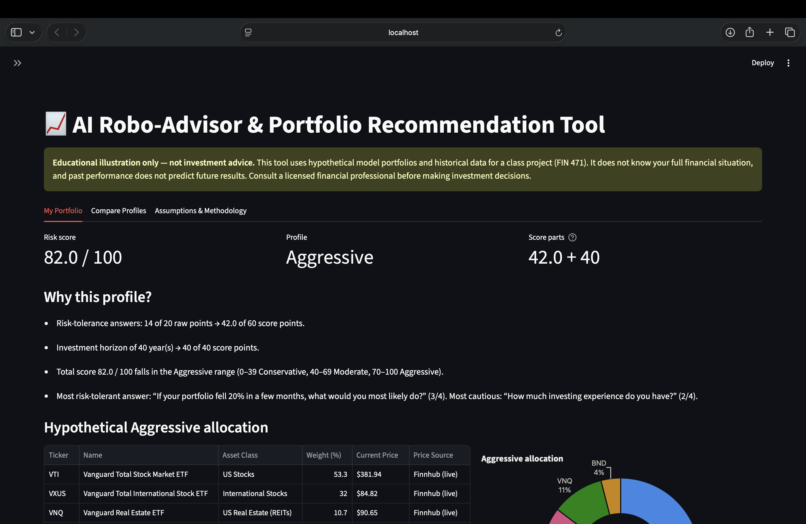
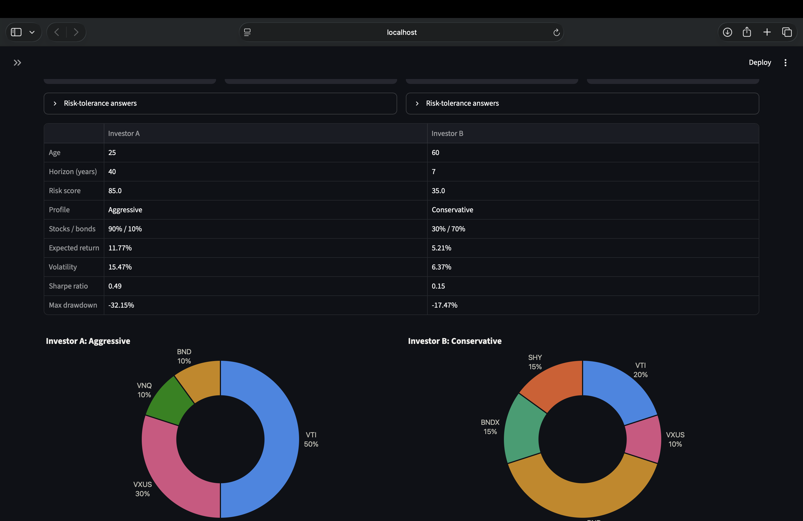

# AI Robo-Advisor & Portfolio Recommendation Tool

*FIN 471 — FinTech and AI Applications in Finance · class project*

> ⚠️ **Educational illustration only — not investment advice.**
> This app uses hypothetical model portfolios and historical market data to demonstrate how a
> robo-advisor works. It does not know your full financial situation, it is not a registered
> investment adviser, and **past performance does not predict future results.** Consult a
> licensed financial professional before making any investment decision.

---

## Purpose

Robo-advisors (Betterment, Wealthfront, Vanguard Digital Advisor, etc.) ask a few questions,
place the investor into a risk profile, and recommend a diversified portfolio of low-cost ETFs.
This project rebuilds that pipeline end to end in Python so each step is **transparent**:

1. A short questionnaire → a documented, numeric **risk score**
2. Score → **Conservative / Moderate / Aggressive** profile
3. Profile → a hypothetical, diversified **ETF allocation**
4. Historical data → estimated **return, risk, Sharpe ratio, drawdown**, and a **projection**

Every formula is shown in the app and in this README, and every data source falls back
gracefully when it is unavailable.

## Features

- **Questionnaire** (sidebar): age, investment horizon, and 5 risk-tolerance questions, with
  validation and friendly messages for every input.
- **Transparent risk scoring**: a 0–100 score with a breakdown and plain-language reasons,
  including a rule that caps short horizons at Conservative.
- **Model ETF portfolios** stored in one config dictionary (`src/portfolios.py`), plus an
  optional ±10-point **stock/bond tilt** slider.
- **Allocation table + donut chart** (ticker, name, asset class, weight, current price).
- **Return & risk metrics** from historical data: annualized return and volatility per ETF,
  covariance matrix, portfolio expected return and volatility (√(w′Σw)), **Sharpe ratio** using
  the live 3-month Treasury rate from FRED, backtest **max drawdown** and CAGR.
- **Monte Carlo projection** of a starting investment over the user's horizon (10th / 50th /
  90th percentile fan chart).
- **Four interactive Plotly charts**: allocation donut, growth of $10,000 for each profile,
  risk-vs-return scatter, projection fan chart.
- **Compare Profiles** tab: two editable investors side by side (defaults: a 25-year-old with
  a 40-year horizon vs. a 60-year-old with a 7-year horizon).
- **Assumptions & Methodology** tab inside the app.
- **Robust data layer**: timeouts, `st.cache_data`, saved copies of the last good API
  responses, and a bundled sample-data CSV, so the app runs with **no internet and no API keys**.
- **Light and dark mode** charts with a colorblind-safe palette.
- **106 pytest tests**, including hand-calculated examples for every financial formula.

## Screenshots

> _Add at least two screenshots to the `screenshots/` folder and update the links below._

| My Portfolio | Compare Profiles |
|---|---|
| <!--  --> _screenshot placeholder_ | <!--  --> _screenshot placeholder_ |

<!-- Optional extra screenshots:


-->

## Installation & running

Requires **Python 3.12 or newer** (tested on 3.13).

```bash
# 1. Get the code
git clone https://github.com/connermartin/Robo_Advisor_-Project.git
cd Robo_Advisor_-Project

# 2. Create and activate a virtual environment
python -m venv .venv
source .venv/bin/activate          # Windows: .venv\Scripts\activate

# 3. Install pinned dependencies
pip install -r requirements.txt

# 4. (Optional) add free API keys
cp .env.example .env               # Windows: copy .env.example .env
#    then open .env and paste your FINNHUB_API_KEY and FRED_API_KEY

# 5. (Recommended, once) replace the synthetic sample data with real prices
python scripts/build_sample_data.py

# 6. Run the app
streamlit run app.py               # opens http://localhost:8501

# 7. Run the tests
python -m pytest
```

The app works without step 4 or step 5. Missing keys or data are shown as clear warnings,
and labeled fallbacks are used instead.

## APIs and datasets

All sources are free. No paid subscription is needed.

| Source | Used for | Free-tier notes | Fallback |
|---|---|---|---|
| [Yahoo Finance via **yfinance**](https://github.com/ranaroussi/yfinance) | 10 years of daily adjusted closing prices for each ETF | No key. Unofficial API, so it can be rate-limited or change without notice. | Last successful download saved in `data/cache/` → bundled `data/sample_prices.csv` |
| [**FRED** API](https://fred.stlouisfed.org/docs/api/fred/) — series [DGS3MO](https://fred.stlouisfed.org/series/DGS3MO) | Risk-free rate (3-month Treasury bill yield) for the Sharpe ratio | Free key from the [FRED API key page](https://fred.stlouisfed.org/docs/api/api_key.html) | Last saved FRED value → **4.00% default, labeled as an assumption** |
| [**Finnhub**](https://finnhub.io/docs/api/quote) `/quote` | Current ETF price shown in the allocation table (display only, not used in any calculation) | Free key from [finnhub.io/register](https://finnhub.io/register). Free tier: ~60 calls/min, US coverage. | Last historical close (or "n/a" when the sample data is synthetic) |

**Finnhub endpoints not used, and why.** As of this project, `/stock/candle` (historical
prices) and the ETF endpoints (`/etf/profile`, `/etf/holdings`, `/etf/sector`, `/etf/country`)
are **premium**. Free keys get "You don't have access to this resource." So historical data
comes from yfinance, and ETF names and asset classes are stored in `src/portfolios.py`.
See [Finnhub pricing](https://finnhub.io/pricing).

**Bundled sample data.** `data/sample_prices.csv` is the offline fallback. The copy in the
repository was produced with `python scripts/build_sample_data.py --synthetic`: **randomly
generated prices** with realistic average returns, volatilities, and correlations, using a
fixed seed. When it is used, the app labels the figures **SYNTHETIC**. Running
`python scripts/build_sample_data.py` with internet access replaces it with real yfinance
prices. `data/sample_prices_meta.json` records which kind of data the file holds.

**ETF universe** (broad, low-cost index funds):

| Ticker | Fund | Asset class |
|---|---|---|
| VTI | Vanguard Total Stock Market ETF | US stocks |
| VXUS | Vanguard Total International Stock ETF | International stocks |
| VNQ | Vanguard Real Estate ETF | US real estate (REITs) |
| BND | Vanguard Total Bond Market ETF | US bonds |
| BNDX | Vanguard Total International Bond ETF | International bonds (USD-hedged) |
| SHY | iShares 1-3 Year Treasury Bond ETF | Short-term US Treasuries |

## Financial concepts, in plain language

| Concept | Formula | What it means |
|---|---|---|
| **Daily return** | r = Pₜ / Pₜ₋₁ − 1 | The percent change in price from one trading day to the next. Adjusted prices include dividends. |
| **Annualized return** | mean(daily r) × 252 | The average daily return scaled up to a year. A year has about 252 trading days. |
| **Volatility** | stdev(daily r) × √252 | How much returns typically swing around their average. Higher volatility means a bumpier ride. Risk grows with the *square root* of time, which is why the scaling uses √252. |
| **Covariance matrix (Σ)** | cov(daily r) × 252 | How each pair of ETFs moves together. This is the key input for diversification. |
| **Portfolio expected return** | Rₚ = w · μ = Σ wᵢ μᵢ | The weighted average of each ETF's return. |
| **Portfolio volatility** | σₚ = √(w′Σw) | Portfolio risk. It is usually *less* than the weighted average of the ETFs' volatilities, because the ETFs don't all move in lockstep. That gap is the benefit of diversification. |
| **Sharpe ratio** | (Rₚ − R_f) / σₚ | The extra return earned over a risk-free Treasury bill, per unit of risk. Higher is better. |
| **Max drawdown** | min( Vₜ / max(V₀…Vₜ) − 1 ) | The worst fall from a previous high in the backtest, i.e. the biggest loss you would have sat through. |
| **CAGR** | (V_end / V_start)^(1/years) − 1 | The steady yearly growth rate that would produce the same ending value. |
| **Monte Carlo projection** | 2,000 simulated paths | Thousands of possible futures, each built from random yearly returns. The 10th–90th percentile band shows the range covering 80% of simulated outcomes. |

## Methodology

### 1. Risk score (0–100)

| Component | Points | Rule |
|---|---|---|
| Risk tolerance | 0–60 | 5 questions, each scored 0 (most cautious) to 4 (most tolerant). Raw total 0–20, scaled: **raw ÷ 20 × 60**. |
| Investment horizon | 0–40 | under 3 years = 0 · 3–5 = 10 · 6–10 = 20 · 11–20 = 30 · over 20 = 40 |

| Score | Profile |
|---|---|
| 0–39 | Conservative |
| 40–69 | Moderate |
| 70–100 | Aggressive |

- **Short-horizon override:** if the horizon is under 3 years, the profile is capped at
  Conservative, because money needed soon shouldn't be exposed to large stock swings.
- **Age** is validated (18–100, and age + horizon ≤ 110) but **adds no points**. The horizon
  already captures the time dimension, so age would be counted twice.

*Example:* answers 3, 3, 3, 3, 3 (raw 15 → 45 points) with a 40-year horizon (40 points)
gives a score of **85 → Aggressive**.

### 2. Model portfolios (weights in %)

| Profile | VTI | VXUS | VNQ | BND | BNDX | SHY | Stocks / bonds |
|---|---|---|---|---|---|---|---|
| Conservative | 20 | 10 | 0 | 40 | 15 | 15 | 30 / 70 |
| Moderate | 35 | 20 | 5 | 25 | 10 | 5 | 60 / 40 |
| Aggressive | 50 | 30 | 10 | 10 | 0 | 0 | 90 / 10 |

To change the allocations, edit `MODEL_PORTFOLIOS` in `src/portfolios.py`. A test checks that
each profile sums to 100. The **tilt slider** moves up to 10 percentage points between the
stock group (VTI, VXUS, VNQ) and the bond group (BND, BNDX, SHY), scaling each group
proportionally and never letting a weight go below 0%.

### 3. Return and risk estimates

1. Download up to 10 years of daily adjusted closes. Keep only dates where all six ETFs have
   a price.
2. Compute simple daily returns, then annualize the mean, volatility, and covariance (252 days).
3. Portfolio expected return = w · μ. Portfolio volatility = √(w′Σw).
4. Sharpe ratio uses the latest FRED DGS3MO yield.
5. **Backtest:** start with $10,000 at target weights and let each holding grow with its daily
   return. **Rebalance to target weights at each month end.** Max drawdown and CAGR come
   from this backtest.
6. **Projection:** each year's return is drawn independently from a lognormal distribution
   matched to the portfolio's expected return and volatility (2,000 paths, fixed seed). A
   lognormal model keeps simulated values above $0. No contributions or withdrawals.

### 4. Assumptions

- 252 trading days per year.
- Expected return and volatility assume weights are held constant (continuous rebalancing).
  The backtest rebalances monthly.
- Expense ratios are already reflected in ETF prices. **Trading costs, taxes, and bid/ask
  spreads are ignored.**
- Historical averages are used as estimates of future returns. They come from a single
  ~10-year period and are **not forecasts**.
- The projection assumes returns are independent from year to year and roughly lognormal.
  Real markets have "fat tails": extreme losses happen more often than this model predicts.
- **Past performance does not predict future results.**

## Error handling

| Situation | What happens |
|---|---|
| Missing or invalid input | Friendly checklist of what's missing. No crash. |
| Missing `FRED_API_KEY` | Warning shown. Last saved rate, or a 4.00% default labeled as an assumption. |
| Missing `FINNHUB_API_KEY` | Warning shown. Last historical close, or "n/a". |
| API down, timeout (8 s), HTTP error, rate limit (429), empty data | `try/except`, `st.warning`, then fallback. Finnhub stops after the first failure instead of retrying each ticker. |
| No internet at all | Saved copy of the last download, or the bundled sample CSV. The app runs fully. |
| Repeated API calls | `st.cache_data` (prices 6 h, rate 1 h, quotes 5 min). **🔄 Refresh data** button in the sidebar. |
| API keys | Read from `.env` via python-dotenv. `.env` is git-ignored. The Finnhub key is sent in a header, and error messages never include keys. |

## Project structure

```
app.py                       Streamlit UI only (layout, widgets, tabs)
src/questionnaire.py         Questions, answer points, input validation
src/risk_profile.py          Risk score formula, profile mapping, explanations
src/portfolios.py            MODEL_PORTFOLIOS config, ETF metadata, tilt logic
src/data_fetch.py            yfinance / FRED / Finnhub with caching and fallbacks
src/analytics.py             Returns, volatility, covariance, Sharpe, backtest, drawdown, Monte Carlo
src/charts.py                Plotly figure builders and color palette
scripts/build_sample_data.py Rebuild data/sample_prices.csv (real or synthetic)
data/sample_prices.csv       Offline fallback prices (+ sample_prices_meta.json)
tests/                       pytest suite (106 tests)
screenshots/                 Screenshots for this README
.env.example                 Template for API keys
```

## Tests

```bash
python -m pytest -v
```

- `tests/test_risk_profile.py`: scoring at every band edge, the short-horizon override,
  validation of bad inputs, portfolio weights, tilt math.
- `tests/test_analytics.py`: hand-calculated examples. For instance, two assets with
  σ = 20% / 10% and ρ = 0.5 at 60/40 give √0.0208 = 14.42% volatility. Also covers Sharpe,
  drawdown of [100, 120, 90, 130, 104] = −25%, a monthly-rebalance backtest worked step by
  step, and Monte Carlo sanity checks.
- `tests/test_data_fetch.py`: every fallback path with the network mocked (offline, missing
  keys, HTTP 429, empty responses, no key leaks).
- `tests/test_charts.py`: figures build, and colors stay tied to each ETF and profile.

## How the AI coding agent was used

> The AI agent did most of the work for me. Claude Code made this website just from a prompt that I created through the software. Claude would periodically ask me questions for clarification if it needed my feedback. The agent went into Github and Streamlit and coded the website for me. 

**Tool(s) used:** Claude Code, Github, Streamlit, FRED, Finnhub, and Apple Terminal

**How I worked with it:**
- _e.g. I gave the AI an extremely detailed prompt and let it run its course. The AI would give me questions for things that it didn't have access to or didn't know. I had to manually put in some commands with Apple Terminal.
  

**What the agent did:**
- _e.g. Scaffolded the project, wrote the modules and tests, researched which Finnhub endpoints are free._

**What I did / decided myself:**
- I decided what the app would measure and what AI to use for this project. 


**Something the agent got wrong or I changed:**
- The agent told me to install the wrong Python application for this website. Besides that misstep, it was perfect.

**What I verified independently:**
- I verified all of the inputs that Claude asked me to check on the website. I also verfied all of the FRED and Finnhub data that Claude used. 

**Reflection: benefits and risks of using an AI agent for financial software:**
- The best thing is the convenience of letting AI deal with finance. The AI is extremely fast and helpful. Using an AI for robo-advisory is also cost-effective. The bad thing is the risk of the AI giving inaccurate data or the risk of an attack. 

## Known limitations and incomplete features

- **Historical estimates aren't forecasts.** A 10-year lookback that includes a strong US
  stock market can make stocks look better than long-run averages would suggest.
- **Synthetic sample data:** until `scripts/build_sample_data.py` is run with internet
  access, the offline fallback uses randomly generated prices (clearly labeled).
- **Live APIs weren't tested in the development environment,** which had no internet access.
  The live yfinance / FRED / Finnhub paths are covered by mocked tests and should be checked
  once with real keys.
- **yfinance is unofficial** and can break or be rate-limited when Yahoo changes its site.
- **Simplified questionnaire:** five questions can't capture goals, debts, taxes, liquidity
  needs, or other assets the way a real adviser would.
- **Only three fixed model portfolios** (plus the tilt). There is no mean-variance
  optimization or efficient frontier.
- **No taxes, fees, or trading costs.** No account types (IRA / 401k / taxable).
- **No contributions or withdrawals** in the projection. Returns are assumed independent from
  year to year, with no fat tails or regime changes.
- **Current Finnhub quotes are display-only** and not used in any calculation.
- **The ETF data window is limited by the youngest fund** (BNDX launched in 2013).

## Disclaimer

This project is an **educational illustration** created for FIN 471. It is **not
personalized investment, tax, or legal advice**, and nothing in it is a recommendation to buy
or sell any security. The portfolios are hypothetical. All figures are estimates based on
historical data and simplifying assumptions. **Past performance does not predict future
results**, and investing involves risk, including possible loss of principal. Consult a
licensed financial professional before making investment decisions.
